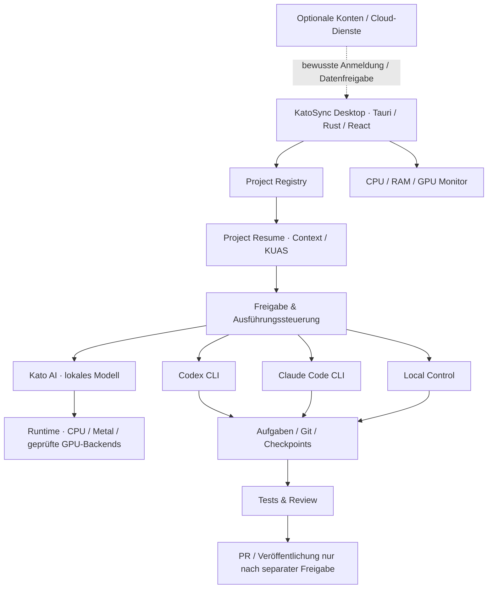
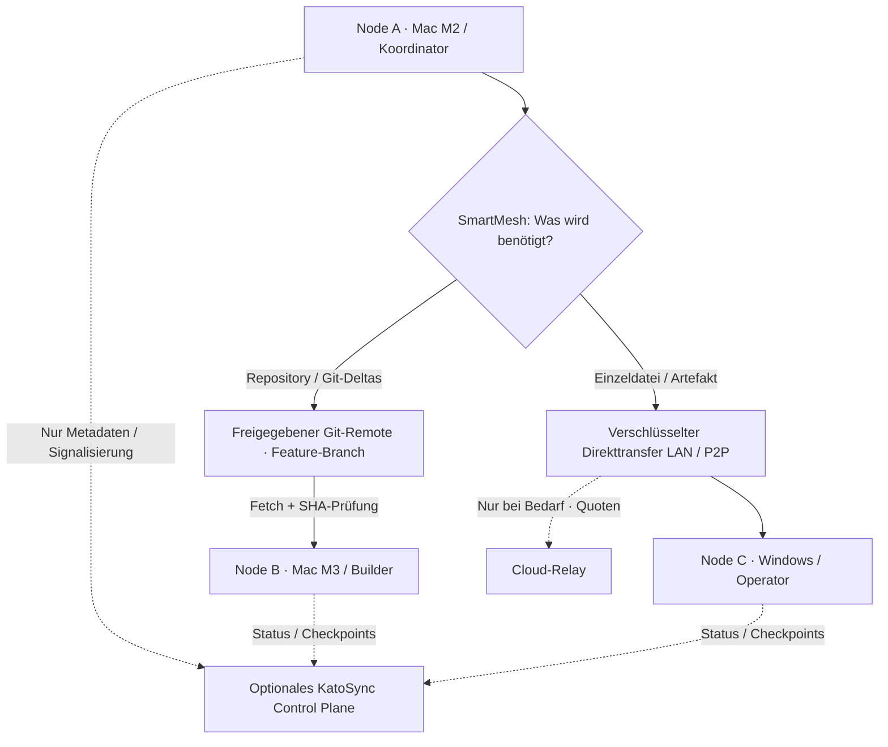

<!-- KatoSync project overview | 2026-11-18 -->

<div align="center">


# KatoSync

### Dein Projekt. Deine Agenten. Ein gemeinsamer Arbeitsraum.

**Local-first Project Work Hub & AI Orchestration für macOS und Windows.**  
Projekte verstehen, Kontext übergeben, Ressourcen überwachen und KI-Arbeit kontrolliert ausführen.

[](docs/KATOSYNC_BETA4_INTEGRATION_20261118.md)
[](https://tauri.app/)
[](https://www.rust-lang.org/)
[](https://react.dev/)

**[Desktop-Releases](https://github.com/NMKato/KatoSync/releases) · [Private Beta-Integration](docs/KATOSYNC_BETA4_INTEGRATION_20261118.md) · [4.0-Roadmap](docs/KATOSYNC_4_0_AGENT_BIRTH_RELEASE_ROADMAP_2026-11-04.md) · [Sicherheit](#sicherheit-und-freigaben)**

<sub>Aus einem Mistral-orientierten Schulprojekt wurde eine plattformübergreifende Arbeitsumgebung für Projekte, lokale KI und mehrere Agenten.</sub>

</div>

---

## Vision

**KatoSync ist mehr als ein Chatfenster oder ein einzelner Coding-Agent.** Die Plattform soll den gesamten Arbeitszyklus zusammenführen: Projekt anlegen oder importieren, den tatsächlichen Stand ermitteln, Wissen für unterschiedliche Modelle aufbereiten, eine Aufgabe gezielt übergeben, Änderungen prüfen und später geräteübergreifend fortsetzen. Das geplante **SmartMesh** macht mehrere autorisierte Geräte zu einem intelligenten Netzwerk für Projektkontext, lokale KI und verteilte Aufgaben.

**Kato AI** bezeichnet dabei unsere lokale Intelligenzschicht: Modell-Runtime, Ressourcensteuerung, Kontext-/Memory-Anbindung und zukünftiges Tool-Routing. Ein konkretes Foundation-Modell ist austauschbare Laufzeitkomponente, nicht die Identität des Produkts. Mistral bleibt eine mögliche externe Integration und ist nicht länger das Zentrum der Architektur.

## 21.11.2026: P0 Native-WebKit-Startgate (Beta-Sperre)

**Kein öffentliches oder natives UX4-Release freigeben:** Der neue
UX4-/Mesh-Quellstand besteht Node-/Browser-/Cargo-Prüfungen, aber die
tatsächlich gestartete macOS-App zeigt ein leeres Fenster. HTML lädt in
der isolierten Diagnose; JavaScript/React dagegen nicht nachgewiesen.
Neue App-Kennung und ein lokaler CSP-Versuch haben den Fehler **nicht**
behoben. Die bisher funktionierende KatoOS-QA-App wurde wiederhergestellt;
Geräte, Schlüsselbund und Candidate11 bleiben geschützt.

**P0-Nachweis:** [Issue #284](https://github.com/NMKato/KatoSync/issues/284)
und [WebKit-Boot-Diagnose](docs/KATOSYNC_UX4_NATIVE_WEBKIT_BOOT_DIAG_20261121.md).
Der nächste Schritt ist ein **gesonderter WebKit-inspectable QA-Build**
zur Identifizierung des konkreten Resource-/JavaScript-Fehlers. Keine
spekulative CSP-Lockerung oder Pairing-Freigabe.

## 21.11.2026: UX4 + Stage4J Mesh-Zusammenführung (private Beta-Quelle)

Der neue QA-Quellzweig `qa/ux4-mesh-composition-20261121` kombiniert
die geprüfte UX4-KatoOS-Anmeldung mit den vorhandenen Stage4J-Mesh-
Sicherheitsgates. Auf dem M3 lieferte die reale native App erstmals wieder
den **lesenden Gerätebestand**; die eigenständige Testinstanz wurde mit
Owner-Go über die signierte Enrollment-UI als siebtes Kontogerät registriert.
Das Hauptgerät bleibt unverändert.

Wichtig: Die **erste Gerätefreigabe und ein echter Remote-Auftrag sind
noch gesperrt**. Der bisherige QA-Build hat die gesonderten
Pairing-Sende-/Empfänger-Flags nicht aktiviert. Der Verbindungsdialog
kennzeichnet das jetzt ausdrücklich und deaktiviert den Erst-Pairing-Button,
statt einen nicht ausgelösten Vorgang als Verbindung darzustellen.

[Live-Nachweise, Feature-Gates, QA und Beta-Grenzen](docs/KATOSYNC_UX4_MESH_BETA_READINESS_20261121.md).
Das Paket ist kein offizielles KatoSync-4.0-Release.

## 21.11.2026: Native UX4-Bedienprüfung und Responsive-Patch (privater QA-Zweig)

Die authentifizierte UX4-KatoOS-Test-App wurde auf M3 mittels echter
macOS-Bedienung durch neun Agent-Sync-Ansichten geführt. Hell/Dunkel/Auto und
das Verkleinern des Fensters wurden kontrolliert geprüft. Candidate 11 ist
regulär geschlossen, die aktuelle QA-App blieb aktiv.

Der getrennte UX-Quellpatch verbessert das 1040-px-Sidebar-Verhalten, benennt
„Darstellung · Sprache“ eindeutig und beendet ausschließlich temporäre
Login-Erfolgshinweise. Alle Freigabe- und Ausführungsgrenzen bleiben unverändert.
Der Patch ist **noch nicht** in die angemeldete laufende native App eingespielt:
[Native UX-Review, Befunde und QA-Gates](docs/KATOSYNC_UX4_NATIVE_UX_AUDIT_20261121.md).

## 20.11.2026: UX4-KatoOS-Loginfix (privater QA-Build)

Der erste native UX4-QA-Build nutzte versehentlich das historische
`github-login-qa`-Auth-Profil; KatoOS-Mitglieder erhielten dabei HTTP 400.
Der isolierte Fix baut **Frontend und Rust gemeinsam** gegen den richtigen
KatoOS-Issuer (`VITE_KATOOS_AUTH_QA=1` + `--features ux4-auth-qa`).
Schlüsselbund, Datenverzeichnis und App-Kennung bleiben getrennt von Candidate 11.

**KatoSync 4.0 KATOOS QA.app** wurde nativ gebaut, lokal signiert und
auf dem M3 gestartet. Die Anmeldung zeigt jetzt korrekt den bestehenden
KatoOS-/KSP-Zugang ohne zweite Registrierung. **Die tatsächliche persönliche
Passwortanmeldung ist noch nicht bestätigt.** Candidate 11 bleibt unverändert.
[Ursache, Fix, QA-Gates und reproduzierbarer Build](docs/KATOSYNC_UX4_KATOOS_AUTH_FIX_20261120.md).

## 20.11.2026: Native M3-UX4-QA (noch kein Release)

Im separaten Zweig `qa/ux4-native-macos-20261120` wurde die vollständige
KatoSync-4.0-Facelift-Quelle erfolgreich unter macOS 27.2 in ein **eigenes,
lokal ad-hoc signiertes** Tauri-App-Bundle überführt. Die App
**KatoSync 4.0 UX QA** (separate Bundle-ID) läuft auf dem M3 aus der externen SSD;
die unveränderte Candidate-11-App bleibt parallel aktiv. Rust 1.95.0 wurde
isoliert installiert, und eine fehlerhafte Stage4Y-Feature-Abgrenzung für
Nicht-Stage4J-QA-Builds wurde mit Regressionstest korrigiert.

Der **native Start und der Login-Screen** wurden geprüft. Eine Anmeldung aus
dem produktiv verwendeten C11-Schlüsselbund wird bewusst nicht übernommen.
Daher müssen die neue Agent-Sync-Ansicht, die Owner-MFA, die Geräteverbindung
und der Live-MCP-Auftrag noch persönlich/eigenständig abgenommen werden.
**Ad-hoc-Signierung ist keine Developer-ID-Notarisierung und keine Freigabe
für einen öffentlichen Installer.**

[Native M3-QA-Nachweis und Reproduktionsschritte](docs/KATOSYNC_UX4_NATIVE_M3_QA_20261120.md).

## 20.11.2026: 4.0-Agent-Sync-Facelift (privater UX-Kandidat)

**Quellstand, noch nicht installiert:** Der isolierte Zweig `feat/ux4-compact-onboarding-20261120`
setzt die freigegebene Hell-/Dunkel-Designvorlage direkt in React um: vier
primäre Provider-/Control-Kacheln, drei sekundäre Integrationszugänge,
kompaktes Onboarding und drei quellengebundene Gerätestatus-/Client-/Projektkarten.
Die Agent-Sync-Navigation wird direkt sichtbar; der **Mistral/Agent-Sync-Schalter
bleibt unverändert**. Hell ist der Default bei einer neuen Präferenz,
Dunkel und Auto sind wählbar. Bestehende Präferenzen bleiben erhalten.

Die Fußzeile zeigt **KatoSync 4.0 · UX Beta** als Designstand, nicht als
bestätigtes natives 4.0-Produktrelease. Ein unbekannter MCP-Grant bleibt
unbestätigt, und keine Aktion genehmigt heimlich Geräte, Tokens oder Projekte.
Implementierung, Testverfahren und offene native Freigaben:
[4.0 Facelift Design- und QA-Protokoll](docs/KATOSYNC_UX4_FACELIFT_20261120.md).

## 20.11.2026: 4.0-Cockpit-UX im isolierten Entwicklungsstand

**Noch kein Release oder installiertes Upgrade:** Der konsolidierte Zweig
`feat/c12-unified-best-of-20261120` vereint das GitHub-C12-Cockpit, die lokale
Sechs-Kachel-Variante und Candidate 11 als unveränderten Rückfallstand.
Er ordnet die Desktop-Navigation neu, bündelt Darstellung/Sprache/Nutzungsvereinbarung
in einem eigenen Einstellungsmenü und zeigt Geräte, Codex, Claude, GitHub,
ChatGPT MCP und lokale KI als ausdrücklich wählbare Verbindungskacheln.
Die Auswahl selbst führt **keine** Anmeldung, Kopplung oder Schreibaktion aus.

Die Übersicht erhält echte, herkunftsgebundene Statusgrafiken aus vorhandenen
Job-Ereignissen, Provider-Wechseln und lokalen Git-Commit-Daten. Ein
Commit-Datum wird nicht fälschlich als Push-Zeitpunkt bezeichnet; fehlende
Messdaten erhalten keine erfundenen Kurven. Vision zeigt die OpenAI-/Anthropic-
Marken auf vorhandenen Provider-Knoten; Verbindungsstatus und Frische werden
unabhängig davon aus den tatsächlichen Lane-Zuständen abgeleitet.

**Nicht als fertig deklarieren:** vollständige 4.0-Agentenaktivierung,
offline-sichere automatische Modellübernahme und Hintergrund-Konterxtpflege,
M3-Modellstart, native ChatGPT-MCP-Jobs, direkter LAN-Test, Windows-Installer
und die übrigen Release-Gates. Die Sicherheits- und Speichergrenzen bleiben
unverändert. Architektur, Tests und manueller Beta-Prüfplan:
[4.0 UX-Cockpit](docs/KATOSYNC_4_0_UX_COCKPIT_20261120.md) und
[Best-of-/MCP-Abnahmegrenzen](docs/KATOSYNC_C12_UNIFIED_MCP_GATES_20261120.md).
Der ursprüngliche [C12-Fünf-Kachel-Testplan](docs/KATOSYNC_C12_UX_COCKPIT_TESTPLAN_20261120.md)
bleibt als historischer Vergleich erhalten.

## Aktueller Stand: Geräte-UX und private Beta

**Quellstand: 19. November 2026.** Der Einstieg bietet jetzt einen direkten
Zugang zu **Meine Geräte**. Die Geräteverwaltung steht vor den Anbieteroptionen:
Kontogeräte aktualisieren, ein Hauptgerät wählen, eine Gegenstelle auswählen
und die Verbindung ausdrücklich bestätigen. Registrierung, gespeicherte
Freigabe und tatsächlich aktive Verbindung bleiben getrennte Zustände.

Der UI-Feinschliff vereinheitlicht Flächen, Abstände, Hell-/Dunkel-Kontraste und
Tastaturfokus. Geräte- und Freigabekarten passen sich schmalen Inhaltsbereichen
an; Escape schließt eine Prüfung ohne Freigabe und bringt den Fokus zum
verfügbaren Auslöser zurück. Der Bereich für lokale KI unterscheidet den
verbauten Arbeitsspeicher vom freien Festplattenspeicher und erklärt den
unveränderten RAM-Schutz beim Start.

Die native App begrenzt eigene Befehle zusätzlich auf ihre aufrufende
Webview. Das QA-Statuswidget darf nur seine sechs Anzeige-, Navigations- und
Fensterbefehle verwenden; Gerätefreigaben, Verbindungssteuerung und
Arbeitsbefehle erreichen von dort aus den App-Dispatcher nicht.

[Gestaltung und Komponentenprüfung](docs/KATOSYNC_DEVICE_UI_POLISH_20261119.md) dokumentiert den gezielten UI-Nachweis.

Die reproduzierbare Komponentenprüfung läuft mit
`node scripts/qa-account-mesh-ui.mjs <ausgabeordner>` und einem vorhandenen
Playwright-Browser. Sie prüft beide Themen, Tastatur- und Freigabeabläufe,
lange Namen, Übersetzungen und ausgewählte Textkontraste. Ihre Beispieldaten
und Modellaktionen sind ausdrücklich synthetisch. Echte Geräteverbindungen,
Modellantworten und persönliche MCP-Freigaben werden separat am jeweils
signierten Kandidaten geprüft. Eine vollständige öffentliche 4.0-Freigabe ist
damit weiterhin nicht verbunden.

### Historische Beta-Integration vom 18. November 2026

**Stand: 18. November 2026.** Der aktuelle Entwicklungszweig verbindet die
vorhandene Kontoanmeldung, Geräteregistrierung und sichere Kopplung mit einem
dauerhaft gestarteten nativen Mesh-Dienst, Rollenwahl, Reconnect und einer
getrennten Remote-MCP-Freigabe. Der frühere Kandidat `b754d170` wurde im
[öffentlichen CI-Lauf](https://github.com/NMKato/KatoSync/actions/runs/44319035816)
gebaut und getestet, lokal mit Developer ID signiert, von Apple notarisiert
und als identisches Paket auf M2 Pro und M3 verifiziert. Zwei echte
60-Sekunden-Clientläufe bestanden mit acht beziehungsweise neun Heartbeats
und bestätigtem Stop. Derselbe Serverprozess verband sich zwischen den
Clientläufen erneut; sein 300-Sekunden-Fenster endete jedoch ohne anwesenden
Client mit Exit 5 und besitzt deshalb **keinen Server-Gesamt-PASS**.
Paket-Hashes, Nachweise und Grenzen stehen im
[Beta-Integrationsprotokoll](docs/KATOSYNC_BETA4_INTEGRATION_20261118.md).

**Der damalige Ablauf:** anmelden → **Verbinden** → eigene aktuelle
Geräteregistrierungen laden → Gegenstelle auswählen → bei Bedarf Einladung
und SAS bestätigen → **Server/Client** wählen → native Verbindung starten.
„Verbunden“ verlangt eine frische, kryptografisch bestätigte Verbindung.
Historische App-Registrierungen, gespeicherte Kopplungen und zuletzt gemeldete
Cloud-Präsenz werden nicht als aktuell erreichbare Computer gezählt.

Für die erste private macOS-Beta ist ein aktives gemeinsames **Tailscale-Konto**
Voraussetzung. Der Mesh-Dienst bindet nur die verifizierte private Adresse,
prüft beide Geräteschlüssel und erneuert seine Berechtigung fortlaufend.
Temporäre Netzfehler werden mit begrenztem Backoff behandelt; Abmelden,
Trennen, falscher Schlüssel und Widerruf schließen den Kanal.

Die bereits registrierte ChatGPT-MCP-Anbindung ist ein separater Zugriffsweg.
Ein erfolgreicher synthetischer Ping ist noch kein Gerätezugriff. Dafür sind
eine exakt gebundene OAuth-Client-Freigabe, aktuelle Gerätefreigabe und echte
native Präsenz nötig. Die neue Freigabeoberfläche führt den Owner durch die
erforderliche frische MFA-Bestätigung.

Die produktive MCP-Providerfreigabe sowie DB-/Worker-Freischaltung und echte
MCP-/MFA-/Gerätefreigabe bleiben offen. Die roten Picomatch-Audits sind
**historische Ergebnisse**: Der frische Registry-Audit vom 18. November um
**17:52 UTC** bestand auf Linux und dem M3 mit **Exit 0 und null Befunden**.
Lockfile und Audit-Schwelle blieben unverändert; der abschließende CI-Lauf
für den neuen Release-Quellstand ist weiter offen.
[Audit-Nachweis und Chronologie](docs/KATOSYNC_BETA4_DEPENDENCY_AUDIT_20261118.md).
Die nachfolgenden Korrekturen für
temporäre Authority-Fehler und einen leichter auffindbaren Verbindungseinstieg
sind im zweiten Kandidaten `232822fb` enthalten. Sein
[nativer CI-Paketbau](https://github.com/NMKato/KatoSync/actions/runs/44327673503)
bestand mit **482 bestandenen, 0 fehlgeschlagenen und 8 ignorierten Tests**; TypeScript und
Vite bestanden einschließlich der korrigierten Rollen-Radiobuttons. Der
vorangehende Node-Lauf bestand mit **984/984 Tests**; die genaue Zuordnung
steht im Beta-Protokoll. Candidate 2 ist inzwischen mit Developer ID signiert,
von Apple notarisiert und als identisches Paket auf beiden Macs geprüft.
Auf M3 wurden Navigation, Mesh-Karte, Rollenwahl und nativer Serverstart
sichtbar geprüft. Zwei M2-Clientläufe bestanden mit sechs beziehungsweise
drei beobachteten Heartbeats und bestätigtem Stop; der anschließende M3-UI-Stop
gab den Listener frei. Remote-Jobs oder neue Pins wurden dabei nicht erzeugt.
Der zuletzt physisch geprüfte dritte Kandidat `0c85c5d0` enthält auch den Fix für die Race beim
ersten Bootstrap. Sein
[nativer CI-Paketbau](https://github.com/NMKato/KatoSync/actions/runs/44336643584)
bestand mit **482 bestandenen und 8 ignorierten Tests**; Linux und Windows
bestanden jeweils **986 Node-Tests**, darunter die sechs Bootstrap-Regressionen.
Candidate 3 ist mit Developer ID signiert und von Apple notarisiert; dasselbe
Paket wurde auf M2 und M3 geprüft. Auf M3 funktionierten Kontoliste, vorhandene
Peer-Auswahl und Serverstart über die GUI ohne die bisher mögliche
120-Sekunden-Wartezeit. Der M2-Client bestand mit **sechs bestätigten
Heartbeats, bestätigtem Stop und Exit 0**. Die M3-GUI zeigte währenddessen
„Sicher verbunden“, nach dem Client-Ende den korrekten Wartezustand und nach
dem UI-Stop „Bereit zum Verbinden“ ohne verbleibenden Mesh-Listener.
Die physischen Durchläufe nutzten bereits gekoppelte Geräte; eine neue
Anfrage samt Annahme wurde damit nicht zusätzlich abgenommen. Auf beiden
Macs verweist die neue sichtbare Verknüpfung `~/Applications/KatoSync Beta4.app`
auf den geprüften Candidate 3; keine bestehende App wurde überschrieben.
Diese eigenen Candidate-3-Nachweise stehen im Beta-Protokoll;
[Integrations-PR #283](https://github.com/NMKato/KatoSync/pull/283) führt den
Quellstand zusammen. Eine vollständige 4.0- oder MCP-Freigabe folgt daraus nicht.

Die bisherigen Sicherheitsnachweise der Stages 4AG–4AM bleiben in ihren
datierten QA-Protokollen erhalten. Quelltests, lokale Test-Sockets und frühere
signierte Pakete werden nicht als Abnahme des aktuellen Kandidaten ausgegeben.
**4.0 bezeichnet das Produktziel; ein vollständiges 4.0-Release ist noch nicht
veröffentlicht.**

### Neuer Quellstand nach Candidate 3

Projektgebundenes RAG ist an registrierte Quellen und SQLite/FTS5 angebunden.
Die lokale Chatansicht bietet jetzt eine ausdrückliche Aktualisierung mit
geprüfter Sicherung und einen **Markdown-/Obsidian-Snapshot-Export** über die
native Ordnerauswahl. Automatische Cross-Repo-Abfragen, das Fortschreiben
von `PROJECT_STATUS_FLOW.md` und Wissensreplikation über Mesh bleiben offen.
[Projektwissen: Umfang und Grenzen](docs/KATOSYNC_BETA4_PROJECT_KNOWLEDGE_20261118.md).

Der neue [native Git-Status](docs/KATOSYNC_BETA4_NATIVE_GIT_STATUS_20261118.md)
bindet den lesenden Aufruf an eine frische Clientfreigabe und die lokal
ausgewählten Projekte. Terminal-/CLI-Fernsteuerung, Computersteuerung und
automatischer Providerwechsel auf das lokale Modell sind damit nicht freigegeben.

**Prüfstand:** Am zusammengeführten Code-Stand `65f664a` bestanden
**997 vollständige Node-Tests** ohne übersprungene Tests sowie der tatsächliche
TypeScript-/Vite-Build auf dem M2. Der lokale native Build erreichte beim
Kompilieren der Abhängigkeiten sein Zeitlimit; daraus folgt kein nativer PASS.
Der abschließende GitHub-Lauf bündelt native Tests und App-Binärdatei.
Die Connector-Integration bestand beide isolierten PostgreSQL-17-Modi.
Produktiv sind die ersten **zwei von vier** Migrationen angewendet; die dritte
Ausführung wurde abgebrochen und nicht erneut gestartet. Client- und
Gerätefreigaben bleiben leer. Der finale Mac-App-Build, die neuen UI-/MCP-/Offline-Läufe
und das vollständige 4.0-Go bleiben offen. Die neuen Quelländerungen sind
kein nachträglicher Funktionsnachweis für das Candidate-3-Paket.

## Was KatoSync zusammenbringt

| Bereich | Funktionen | Status |
| :-- | :-- | :-- |
| **Agent Sync & Live-Monitor** | Codex/Claude-Anbindung, Provider-Status, lokale Runner, Aufgaben- und Ausführungsansichten | Desktop-Beta; einzelne Geräteszenarien noch in Prüfung |
| **Project Work Hub** | Projektregister, sichere lokale Projektanlage, Git-/Worktree-Kontext, Resume-Paket und Herkunftsnachweise | Integrierter, getesteter **Draft-PR #75** |
| **Context Bridge** | Projektbezogene MCP-/CLI-Leseschnittstelle mit expliziter Allowlist; Übergabe zwischen Tools vorbereiten | **Read-only Preview** in PR #75 |
| **Projektwissen / Memory Fabric** | Projektgebundenes RAG, manuelle Aktualisierung mit Sicherung, Markdown-/Obsidian-Snapshot | Aktueller Beta4-Quellstand; neue native End-to-End-Abnahme offen. Cross-Repo-/Mesh-Wissensreplikation bleibt ausstehend. |
| **KUAS** | Versionierte, providerübergreifende Agentenregeln und nachvollziehbare Laufmetadaten | In PR #75 integriert; **keine** Berechtigungssandbox |
| **Kato AI / Local Brain** | Eigene lokale Modell-Runtime, Statusprüfung, Metal-/CUDA-Kandidatenerkennung und CPU-Fallback | macOS-Metal auf echtem Gerät geprüft; Windows-GPU-Inferenz offen |
| **System Resources** | Live-CPU, verfügbarer RAM, GPU-Anzeige, Warnungen bei geringer Speicherreserve | macOS-GUI geprüft, Windows-Bibliothekstests grün; PR #75 |
| **Local Control Bridge** | Strukturierte lokale Aufträge über Inbox/Outbox, Heartbeat und Ausführungsprotokolle | Bestehender lokaler Integrationspfad |
| **SmartMesh / Fleet** | Kontogeräte finden, sichere Kopplung, Server-/Client-Rolle, nativer TLS-Kanal, Heartbeat und Wiederverbinden | Private macOS-Integration; aktueller Paket-/Gerätenachweis im [Beta-Protokoll](docs/KATOSYNC_BETA4_INTEGRATION_20261118.md). Verteilte Jobs bleiben gesondert freizugeben. |
| **Sichere autonome Zusammenarbeit** | Isolierte Task-Worktrees, exklusiver Writer-Lease, abgestufte Schreib-/Netzwerkfreigaben | **Release-Blocker**, [Issue #76](https://github.com/NMKato/KatoSync/issues/76) |

**Wichtig:** „Integriert“ und „getestet“ bedeuten nicht automatisch „im Download enthalten“. Nicht freigegebene Workflows und unbeaufsichtigtes Codeschreiben bleiben ausdrücklich beschränkt.

## Architektur



Der Desktop-Kern basiert auf **Tauri 2 + Rust**, das Frontend auf **React und TypeScript**. Das Architekturziel ist **local-first und providerneutral**: Lokale Arbeitsdaten bleiben standardmäßig auf dem Gerät; Cloud- und Drittanbieterzugriffe benötigen passende Konten, Konfiguration und Freigaben. Externe Modellprovider können eigene Abonnements, API-Kosten und Datenverarbeitung mitbringen.

### So soll sich die Arbeit anfühlen

1. **Projekt öffnen:** Bestehendes Repository registrieren oder ein neues Projekt sicher anlegen.
2. **Kontext verstehen:** Aktuellen Git-Stand, relevante Dateien, Regeln und den letzten Checkpoint zusammenstellen.
3. **Agent wählen:** Codex, Claude, Kato AI oder eine andere unterstützte lokale Schnittstelle.
4. **Arbeit freigeben:** Dateien, Netzwerkzugriffe und Schreibumfang vorab begrenzen.
5. **Ergebnis prüfen:** Tests, Herkunft, Änderungen und Übergabestatus nachvollziehen.
6. **Fortsetzen:** Projekt später auf demselben oder perspektivisch einem anderen Gerät weiterführen.

Die Schritte 4–6 beschreiben teilweise den **Zielablauf**, nicht bereits eine allgemein freigegebene autonome Ausführung.

## Kato AI – die lokale Intelligenz

Kato AI kombiniert eine austauschbare lokale Modell-Runtime mit Status-, Speicher- und künftig Kontext- und Werkzeugfunktionen. Die lokale Ausführung ist unabhängig davon, ob Codex oder Claude angemeldet sind. Ein laufendes Modell kann beim Neustart der Oberfläche wiedererkannt werden; die Ressourcenanzeige berücksichtigt dabei den eigenen verwalteten Prozess.

Der macOS-Test auf einem **M2 Pro** hat eine funktionierende lokale Inferenz mit **Metal** bestätigt. Die angezeigte GPU-Auslastung beschreibt dabei das **gesamte Gerät**, nicht die eindeutig gemessene GPU-Auslastung eines einzelnen Modells. Die Windows-Tests beweisen noch **keine** verpackte CUDA- oder Intel-GPU-Inferenz. Fremde Modellprozesse werden nicht automatisch beendet.

## KatoSync SmartMesh – gemeinsam arbeiten, Hardware sinnvoll nutzen

> **Private Beta:** Geräteauswahl und nativer Mesh-Verbindungsdienst werden im aktuellen Kandidaten zusammengeführt. Git-Übergabe, automatische Aufgabenverteilung und Schreibausführung besitzen weitere Sicherheits- und Geräteabnahmen. [Ablauf und Prüfstatus](docs/KATOSYNC_BETA4_INTEGRATION_20261118.md), [Orchestrierungs-Gate #76](https://github.com/NMKato/KatoSync/issues/76).

**Eine Installation, ein intelligenter Node. Mehrere autorisierte Installationen, ein koordinierter Projektarbeitsraum.** Jeder Node erhält eine dauerhafte, widerrufbare Geräteidentität und einen selbst vorgeschlagenen, vom Nutzer änderbaren Namen – zum Beispiel „M2 Koordinator“, „M3 Builder“ oder „Windows Operator“. Seine Rolle orientiert sich an **wirklich gemessenen** Fähigkeiten, nicht an einer bloßen KI-Behauptung.



### Git-first statt ganze Repositories durchs Netz zu kopieren

Für ein **bestehendes, genehmigtes Git-Projekt** ist Git normalerweise der effizienteste Austauschweg: Ein berechtigter Node erstellt nach der erforderlichen Arbeitsfreigabe einen überprüften Commit auf einem **separaten Feature-Branch**. Andere berechtigte Nodes holen mit ihren **eigenen** Git-Zugängen nur die benötigten Objekte und prüfen Commit-SHA, Branch und Projektkontext. Ein geschützter Hauptzweig wird nicht automatisch verändert; Push, Merge und Veröffentlichung haben gesonderte Freigaben.

Für **einzelne genehmigte Dateien, Artefakte oder private lokale Projekte** wird vorzugsweise direkt verschlüsselt übertragen: zuerst LAN/WLAN, dann direkte Internet-P2P-Verbindung, erst bei Bedarf ein kostenpflichtiger Relay. Hashes, begrenzte Pfadberechtigungen und wiederaufnehmbare Transfers schützen die Übergabe. Nicht jedes private Projekt darf auf einem externen Git-Server veröffentlicht werden.

**Nodes koordinieren Berechtigungen, nicht Geheimnisse:** Jeder Node prüft selbst, ob er für einen Remote Lese- oder Schreibrechte besitzt. Fehlt ein Zugang, fragt KatoSync nach einer ordentlichen Autorisierung. **Keine Weitergabe von Git-Tokens, privaten SSH-Schlüsseln, Passwörtern oder Provider-Sitzungen von Gerät zu Gerät.** KI-Agenten schlagen Arbeitsweg und zuständigen Node vor; technische Richtlinien und die geräteübergreifende Einzel-Schreibsperre entscheiden, was tatsächlich ausgeführt werden darf.

### Leistung intelligent verteilen

SmartMesh soll verfügbare CPU, **freien** Arbeitsspeicher, erkannte GPU, nachgewiesene Backend-Beschleunigung, dedizierten VRAM **oder** gemeinsam genutzten Speicher sowie Toolchains, Laufzeitlast und Akkuzustand berücksichtigen. Damit kann beispielsweise ein GPU-Node eine lokale Modellanfrage, ein Mac den Xcode-Build und Windows eine plattformspezifische Prüfung übernehmen. **Mehrere Computer bilden dadurch aber nicht automatisch einen gemeinsamen RAM-/VRAM-Speicher.** Die aktuelle Ressourcenüberwachung liefert dafür erste technische Grundlagen; die automatische geräteübergreifende Planung ist noch offen.

Für diesen internen Test werden keine kommerziellen Tarife oder Leistungszusagen veröffentlicht. Frühere Free-/Pro-Entwürfe enthalten unterschiedliche Mesh-Kontingente und müssen vor einem bezahlten Release mit Produkt, Billing und Server-Limits vereinheitlicht werden. Historische App-Identitäten dürfen nicht ohne geprüfte Zuordnung als zusätzliche physische Geräte berechnet werden.

## Plattformstatus & Qualitätsnachweise

**Historischer Baseline-Nachweis vom 21. Oktober 2026**, [Integrations-PR #75](https://github.com/NMKato/KatoSync/pull/75). Diese Zahlen gelten nicht für den neuen Beta-Kandidaten. Aktuelle Prüfungen und offene Geräte-/Paket-Gates: [Beta-Integrationsprotokoll](docs/KATOSYNC_BETA4_INTEGRATION_20261118.md).

| Test | Ergebnis |
| :-- | :-- |
| macOS Rust-Bibliothek | 119 bestanden, 3 bewusst ignoriert |
| Windows Rust-Bibliothek | 118 bestanden, 3 bewusst ignoriert |
| macOS Node | 165 bestanden |
| Windows Node | 161 bestanden, 4 plattformbedingt übersprungen |
| GitHub PR Fast Gate / Windows Node / Web-Build | erfolgreich |
| GitHub Attribution Policy | erfolgreich |
| Vollständiger Windows-GUI-/Installer-Test | **offen** |
| Signierter/notarisierter vollständiger Release mit echten Typst-/Poppler-Ressourcen | **offen** |

Die native QA der neuen Integration wurde aus isolierten Testständen gefahren. Eine vorhandene macOS-GPU-Test-App ist **kein** allgemein freigegebenes Installationspaket. Alle relevanten Ergebnisse und Grenzen stehen im [Release-Candidate-Protokoll](https://github.com/NMKato/KatoSync/blob/integration/katosync-work-hub-gpu-candidate-20261021/docs/KATOSYNC_UNIFIED_RELEASE_CANDIDATE_2026-10-21.md).

## Sicherheit und Freigaben

KatoSync soll **nachweisbare technische Freigaben** bieten, nicht nur freundliche Regeln in einem KI-Prompt. Deshalb bleiben folgende Grenzen sichtbar:

- Ein KUAS-Regeltext oder ein „Auto“-Schalter verleiht **keine** Schreib-, Shell-, Netzwerk- oder Veröffentlichungserlaubnis.
- Bestehende native Runner sind **noch nicht** vollständig auf isolierte Task-Worktrees mit einem geräteübergreifenden **Single-Writer-Lease** umgestellt.
- Die neue Projekt-MCP-Brücke ist **lesend**; sie erteilt keine Schreibrechte.
- Projektkontext, private Dokumente, Zugangsdaten und Provider-spezifische Berechtigungen werden nicht pauschal an andere Modelle übertragen.
- Produktive Systeme, automatische Merges und unbeaufsichtigte Schreibaufgaben erhalten erst nach unabhängiger Sicherheitsabnahme eine Freigabe.

Details und Akzeptanzkriterien: [Security Gate #76](https://github.com/NMKato/KatoSync/issues/76). Bitte die Beta nicht als unbeaufsichtigten Agenten mit uneingeschränkten Systemrechten einsetzen.

## Installation und Entwicklung

**Für Nutzer:** Bestehende macOS-Builds sind unter [GitHub Releases](https://github.com/NMKato/KatoSync/releases) verfügbar. Prüfe bei jedem Download Version, Plattform und Release-Hinweise. Der neue Project Work Hub und ein vollständig geprüfter Windows-Installer sind **noch nicht** als allgemeiner Release verfügbar.

**Für Entwickler** (Node.js, Rust und native Tauri-Voraussetzungen erforderlich):

```bash
git clone https://github.com/NMKato/KatoSync.git
cd KatoSync
npm ci
npm run dev
# Native Desktop-Entwicklung:
npm run tauri dev
# Frontend-Check:
npm run build
```

Für die neue Projekt-/Ressourcenintegration siehe [PR #75](https://github.com/NMKato/KatoSync/pull/75). Ein Quellcode-Build ist nicht gleichbedeutend mit signierten offiziellen Installern oder einer freigegebenen Backend-Anbindung.

## Community, Accounts und geplante Dienste

Die **lokale Nutzung und selbst betriebene Infrastruktur** sollen vom optionalen verwalteten KatoOS-Dienst getrennt sein. Angedacht ist ein Einstiegsangebot für Konten und begrenzte Synchronisation sowie ein kostenpflichtiger Dienst für zusätzliche Cloud-Funktionen und Kapazitäten. **Tarife, Preise, Gratis-Kontingente und Hosted-AI-Nutzung sind noch nicht beschlossen oder zugesichert.**

Ein Konto allein soll keine unbegrenzte Nutzung kostenpflichtiger KI-Modelle, GPU-Inferenz, Cloud-Speicher oder API-Weiterleitungen freischalten. Externe KI-Abos/API-Tarife können separat anfallen. Vor einem öffentlichen Ausbau werden Quoten, Missbrauchsschutz, Datenschutzbedingungen und Abrechnung geprüft.

**Quellcode und Lizenz:** Dieses Repository ist öffentlich einsehbar. Eine ausdrückliche Open-Source-Lizenz ist zum Stand dieser README **noch nicht im Repository nachgewiesen**. Öffentlich zugänglicher Quellcode ist ohne passende Lizenz nicht automatisch Open Source. Nutzungs-, Änderungs- und Weitergaberechte müssen vor einem Open-Source-Release durch eine Lizenz geklärt werden. Eine spätere verwaltete Cloud-Leistung kann unabhängig davon kostenpflichtig sein.

## Screenshots & Demo

Eine neue, plattformübergreifende Bilderstrecke ist geplant: **Project Work Hub**, **Agent Sync**, **Kato AI**, **CPU/RAM/GPU**, **SmartMesh / Fleet-Topologie**, **Live-Monitor**, **Checkpoints** und **Windows/macOS**. Wir ergänzen verifizierte Screenshots und kurze Demos erst nach der GUI-/Release-Abnahme, damit keine veraltete Mistral-Oberfläche als aktueller Funktionsstand erscheint.

## Roadmap

Die verbindlichen 4.0-Ziele und ihre getrennten Abnahmen stehen in der [Agent-Birth- und Release-Roadmap](docs/KATOSYNC_4_0_AGENT_BIRTH_RELEASE_ROADMAP_2026-11-04.md). Die folgende Übersicht enthält die bereits vorhandene Basis und weiterhin offene Gesamtziele; ein Mesh-Test erfüllt nicht automatisch Agenten-, Billing- oder Windows-Gates.

- [x] Lokaler Runner / Agent Sync und Local Control als technische Basis
- [x] Projektregister, Projektanlage, Resume-Kontext, KUAS und read-only MCP-Brücke im Integrations-Draft
- [x] CPU-/RAM-/GPU-Dashboard und realer macOS-Metal-Test
- [x] Native macOS- und Windows-Regression der Integrationsrunde
- [ ] [#76: isolierte Worktrees, Freigaben, dauerhafter Writer-Lease](https://github.com/NMKato/KatoSync/issues/76)
- [ ] Durchgehender Test: Projekt → freigegebener Agentenwechsel → Edit → Checkpoint → unabhängige Tests
- [ ] Vollständige Windows- und macOS-Installer mit realen Ressourcen, GUI-/Gerätetests, Signierung
- [ ] SmartMesh: vertrauenswürdige Gerätenamen/Identitäten, Fähigkeitsrouting, Git-first-Handoff, LAN/P2P/Relay-Fallback, unabhängige Git-Logins und Remote-Writer-Lease
- [ ] Durchgehende Geräteabnahme für projektgebundenes RAG, manuellen Refresh und Obsidian-Snapshot-Export
- [ ] Automatische Cross-Repo-Abfragen, Project-Status-Flow-Writer und Mesh-Wissensreplikation
- [ ] Verifizierter automatischer Provider-/Local-Brain-Fallback und freigegebene Terminal-/Computersteuerung
- [ ] Optionale Cloud-Tarife, Limits und Datenschutz-/Sicherheitsabnahme
- [ ] Neue Screenshots, Demo-Video, Download-Seite und eindeutig definierte Open-Source-Lizenz

## Herkunft des Projekts

KatoSync begann als **Schulprojekt rund um Mistral und die Übergabe von KI-Aufgaben an lokale Runner**. Daraus entwickelte sich eine größere Vision: **ein gemeinsames Betriebssystem für projektbezogene KI-Arbeit**, das Werkzeuge, Modelle und Rechner koordinieren soll, ohne die Kontrolle über Code, Daten und Kosten aufzugeben.

---

<details>
<summary><strong>English summary</strong></summary>

**KatoSync** is a local-first project workspace and AI orchestration desktop app built with Tauri, Rust, React and TypeScript. It brings project registration and resumption, context sharing, Codex/Claude runners, a local **Kato AI** runtime, and CPU/RAM/GPU monitoring into one interface. The planned **SmartMesh** connects independently authenticated nodes, prefers Git for approved repository handoffs and encrypted LAN/P2P transfers for files, and routes authorized tasks to capable CPU/GPU machines. Nodes do not share raw credentials or magically pool physical RAM/VRAM.

The latest Project Work Hub + GPU integration has passed macOS and Windows native source tests, but remains a **draft integration**, not a generally released cross-platform installer. Safe unattended code-writing is blocked until isolated worktrees, scoped permissions and a verifiable single-writer lease are independently reviewed. Managed accounts and paid cloud services are being considered, but no pricing or service entitlements are promised. Repository licensing has not yet been finalized.

</details>

<div align="center">
<sub>Ein Projekt von <strong>KatoOS / NMKato Solutions</strong> · Entwicklung und Dokumentation: November 2026</sub>
</div>
