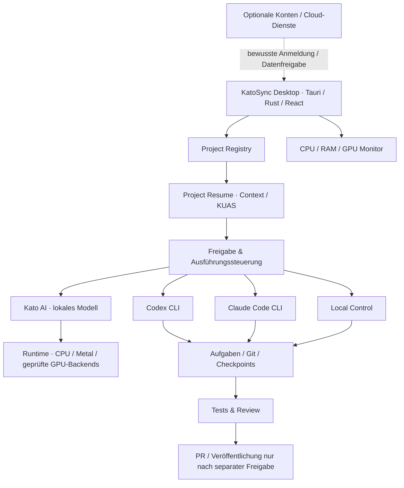

<!-- KatoSync public project overview | 2026-10-21 -->

<div align="center">


# KatoSync

### Dein Projekt. Deine Agenten. Ein gemeinsamer Arbeitsraum.

**Local-first Project Work Hub & AI Orchestration für macOS und Windows.**  
Projekte verstehen, Kontext übergeben, Ressourcen überwachen und KI-Arbeit kontrolliert ausführen.

[](https://github.com/NMKato/KatoSync/pulls)
[](https://github.com/NMKato/KatoSync/pull/75)
[](https://github.com/NMKato/KatoSync/pull/75)
[](https://tauri.app/)
[](https://www.rust-lang.org/)
[](https://react.dev/)

**[Desktop-Releases](https://github.com/NMKato/KatoSync/releases) · [Aktuelle Integration](https://github.com/NMKato/KatoSync/pull/75) · [Roadmap](#roadmap) · [Sicherheit](#sicherheit-und-freigaben)**

<sub>Aus einem Mistral-orientierten Schulprojekt wurde eine plattformübergreifende Arbeitsumgebung für Projekte, lokale KI und mehrere Agenten.</sub>

</div>

---

## Vision

**KatoSync ist mehr als ein Chatfenster oder ein einzelner Coding-Agent.** Die Plattform soll den gesamten Arbeitszyklus zusammenführen: Projekt anlegen oder importieren, den tatsächlichen Stand ermitteln, Wissen für unterschiedliche Modelle aufbereiten, eine Aufgabe gezielt übergeben, Änderungen prüfen und später geräteübergreifend fortsetzen.

**Kato AI** bezeichnet dabei unsere lokale Intelligenzschicht: Modell-Runtime, Ressourcensteuerung, Kontext-/Memory-Anbindung und zukünftiges Tool-Routing. Ein konkretes Foundation-Modell ist austauschbare Laufzeitkomponente, nicht die Identität des Produkts. Mistral bleibt eine mögliche externe Integration und ist nicht länger das Zentrum der Architektur.

> **Entwicklungsstatus (21.10.2026):** Die öffentlich verfügbaren Desktop-Betas und der neuere Project Work Hub haben unterschiedliche Freigabestände. Die Integration der neuen Projekt- und GPU-Funktionen ist erfolgreich getestet, aber **noch nicht in `dev` oder `main` gemergt oder als vollständig geprüfter Installer veröffentlicht**. Details: [Draft-PR #75](https://github.com/NMKato/KatoSync/pull/75).

## Was KatoSync zusammenbringt

| Bereich | Funktionen | Status |
| :-- | :-- | :-- |
| **Agent Sync & Live-Monitor** | Codex/Claude-Anbindung, Provider-Status, lokale Runner, Aufgaben- und Ausführungsansichten | Desktop-Beta; einzelne Geräteszenarien noch in Prüfung |
| **Project Work Hub** | Projektregister, sichere lokale Projektanlage, Git-/Worktree-Kontext, Resume-Paket und Herkunftsnachweise | Integrierter, getesteter **Draft-PR #75** |
| **Context Bridge** | Projektbezogene MCP-/CLI-Leseschnittstelle mit expliziter Allowlist; Übergabe zwischen Tools vorbereiten | **Read-only Preview** in PR #75 |
| **KUAS** | Versionierte, providerübergreifende Agentenregeln und nachvollziehbare Laufmetadaten | In PR #75 integriert; **keine** Berechtigungssandbox |
| **Kato AI / Local Brain** | Eigene lokale Modell-Runtime, Statusprüfung, Metal-/CUDA-Kandidatenerkennung und CPU-Fallback | macOS-Metal auf echtem Gerät geprüft; Windows-GPU-Inferenz offen |
| **System Resources** | Live-CPU, verfügbarer RAM, GPU-Anzeige, Warnungen bei geringer Speicherreserve | macOS-GUI geprüft, Windows-Bibliothekstests grün; PR #75 |
| **Local Control Bridge** | Strukturierte lokale Aufträge über Inbox/Outbox, Heartbeat und Ausführungsprotokolle | Bestehender lokaler Integrationspfad |
| **Sichere autonome Zusammenarbeit** | Isolierte Task-Worktrees, exklusiver Writer-Lease, abgestufte Schreib-/Netzwerkfreigaben | **Release-Blocker**, [Issue #76](https://github.com/NMKato/KatoSync/issues/76) |

**Wichtig:** „Integriert“ und „getestet“ bedeuten nicht automatisch „im Download enthalten“. Nicht freigegebene Workflows und unbeaufsichtigtes Codeschreiben bleiben ausdrücklich beschränkt.

## Architektur



Der Desktop-Kern basiert auf **Tauri 2 + Rust**, das Frontend auf **React und TypeScript**. Das Architekturziel ist **local-first und providerneutral**: Lokale Arbeitsdaten bleiben standardmäßig auf dem Gerät; Cloud- und Drittanbieterzugriffe benötigen passende Konten, Konfiguration und Freigaben. Externe Modellprovider können eigene Abonnements, API-Kosten und Datenverarbeitung mitbringen.

### So soll sich die Arbeit anfühlen

1. **Projekt öffnen:** Bestehendes Repository registrieren oder ein neues Projekt sicher anlegen.
2. **Kontext verstehen:** Aktuellen Git-Stand, relevante Dateien, Regeln und den letzten Checkpoint zusammenstellen.
3. **Agent wählen:** Codex, Claude, Kato AI oder eine andere unterstützte lokale Schnittstelle.
4. **Arbeit freigeben:** Dateien, Netzwerkzugriffe und Schreibumfang vorab begrenzen.
5. **Ergebnis prüfen:** Tests, Herkunft, Änderungen und Übergabestatus nachvollziehen.
6. **Fortsetzen:** Projekt später auf demselben oder perspektivisch einem anderen Gerät weiterführen.

Die Schritte 4–6 beschreiben teilweise den **Zielablauf**, nicht bereits eine allgemein freigegebene autonome Ausführung.

## Kato AI – die lokale Intelligenz

Kato AI kombiniert eine austauschbare lokale Modell-Runtime mit Status-, Speicher- und künftig Kontext- und Werkzeugfunktionen. Die lokale Ausführung ist unabhängig davon, ob Codex oder Claude angemeldet sind. Ein laufendes Modell kann beim Neustart der Oberfläche wiedererkannt werden; die Ressourcenanzeige berücksichtigt dabei den eigenen verwalteten Prozess.

Der macOS-Test auf einem **M2 Pro** hat eine funktionierende lokale Inferenz mit **Metal** bestätigt. Die angezeigte GPU-Auslastung beschreibt dabei das **gesamte Gerät**, nicht die eindeutig gemessene GPU-Auslastung eines einzelnen Modells. Die Windows-Tests beweisen noch **keine** verpackte CUDA- oder Intel-GPU-Inferenz. Fremde Modellprozesse werden nicht automatisch beendet.

## Plattformstatus & Qualitätsnachweise

Stand: **21. Oktober 2026**, [Integrations-PR #75](https://github.com/NMKato/KatoSync/pull/75).

| Test | Ergebnis |
| :-- | :-- |
| macOS Rust-Bibliothek | 119 bestanden, 3 bewusst ignoriert |
| Windows Rust-Bibliothek | 118 bestanden, 3 bewusst ignoriert |
| macOS Node | 165 bestanden |
| Windows Node | 161 bestanden, 4 plattformbedingt übersprungen |
| GitHub PR Fast Gate / Windows Node / Web-Build | erfolgreich |
| GitHub Attribution Policy | erfolgreich |
| Vollständiger Windows-GUI-/Installer-Test | **offen** |
| Signierter/notarisierter vollständiger Release mit echten Typst-/Poppler-Ressourcen | **offen** |

Die native QA der neuen Integration wurde aus isolierten Testständen gefahren. Eine vorhandene macOS-GPU-Test-App ist **kein** allgemein freigegebenes Installationspaket. Alle relevanten Ergebnisse und Grenzen stehen im [Release-Candidate-Protokoll](https://github.com/NMKato/KatoSync/blob/integration/katosync-work-hub-gpu-candidate-20261021/docs/KATOSYNC_UNIFIED_RELEASE_CANDIDATE_2026-10-21.md).

## Sicherheit und Freigaben

KatoSync soll **nachweisbare technische Freigaben** bieten, nicht nur freundliche Regeln in einem KI-Prompt. Deshalb bleiben folgende Grenzen sichtbar:

- Ein KUAS-Regeltext oder ein „Auto“-Schalter verleiht **keine** Schreib-, Shell-, Netzwerk- oder Veröffentlichungserlaubnis.
- Bestehende native Runner sind **noch nicht** vollständig auf isolierte Task-Worktrees mit einem geräteübergreifenden **Single-Writer-Lease** umgestellt.
- Die neue Projekt-MCP-Brücke ist **lesend**; sie erteilt keine Schreibrechte.
- Projektkontext, private Dokumente, Zugangsdaten und Provider-spezifische Berechtigungen werden nicht pauschal an andere Modelle übertragen.
- Produktive Systeme, automatische Merges und unbeaufsichtigte Schreibaufgaben erhalten erst nach unabhängiger Sicherheitsabnahme eine Freigabe.

Details und Akzeptanzkriterien: [Security Gate #76](https://github.com/NMKato/KatoSync/issues/76). Bitte die Beta nicht als unbeaufsichtigten Agenten mit uneingeschränkten Systemrechten einsetzen.

## Installation und Entwicklung

**Für Nutzer:** Bestehende macOS-Builds sind unter [GitHub Releases](https://github.com/NMKato/KatoSync/releases) verfügbar. Prüfe bei jedem Download Version, Plattform und Release-Hinweise. Der neue Project Work Hub und ein vollständig geprüfter Windows-Installer sind **noch nicht** als allgemeiner Release verfügbar.

**Für Entwickler** (Node.js, Rust und native Tauri-Voraussetzungen erforderlich):

```bash
git clone https://github.com/NMKato/KatoSync.git
cd KatoSync
npm install
npm run dev
# Native Desktop-Entwicklung:
npm run tauri dev
# Frontend-Check:
npm run build
```

Für die neue Projekt-/Ressourcenintegration siehe [PR #75](https://github.com/NMKato/KatoSync/pull/75). Ein Quellcode-Build ist nicht gleichbedeutend mit signierten offiziellen Installern oder einer freigegebenen Backend-Anbindung.

## Community, Accounts und geplante Dienste

Die **lokale Nutzung und selbst betriebene Infrastruktur** sollen vom optionalen verwalteten KatoOS-Dienst getrennt sein. Angedacht ist ein Einstiegsangebot für Konten und begrenzte Synchronisation sowie ein kostenpflichtiger Dienst für zusätzliche Cloud-Funktionen und Kapazitäten. **Tarife, Preise, Gratis-Kontingente und Hosted-AI-Nutzung sind noch nicht beschlossen oder zugesichert.**

Ein Konto allein soll keine unbegrenzte Nutzung kostenpflichtiger KI-Modelle, GPU-Inferenz, Cloud-Speicher oder API-Weiterleitungen freischalten. Externe KI-Abos/API-Tarife können separat anfallen. Vor einem öffentlichen Ausbau werden Quoten, Missbrauchsschutz, Datenschutzbedingungen und Abrechnung geprüft.

**Quellcode und Lizenz:** Dieses Repository ist öffentlich einsehbar. Eine ausdrückliche Open-Source-Lizenz ist zum Stand dieser README **noch nicht im Repository nachgewiesen**. Öffentlich zugänglicher Quellcode ist ohne passende Lizenz nicht automatisch Open Source. Nutzungs-, Änderungs- und Weitergaberechte müssen vor einem Open-Source-Release durch eine Lizenz geklärt werden. Eine spätere verwaltete Cloud-Leistung kann unabhängig davon kostenpflichtig sein.

## Screenshots & Demo

Eine neue, plattformübergreifende Bilderstrecke ist geplant: **Project Work Hub**, **Agent Sync**, **Kato AI**, **CPU/RAM/GPU**, **Live-Monitor**, **Checkpoints** und **Windows/macOS**. Wir ergänzen verifizierte Screenshots und kurze Demos erst nach der GUI-/Release-Abnahme, damit keine veraltete Mistral-Oberfläche als aktueller Funktionsstand erscheint.

## Roadmap

- [x] Lokaler Runner / Agent Sync und Local Control als technische Basis
- [x] Projektregister, Projektanlage, Resume-Kontext, KUAS und read-only MCP-Brücke im Integrations-Draft
- [x] CPU-/RAM-/GPU-Dashboard und realer macOS-Metal-Test
- [x] Native macOS- und Windows-Regression der Integrationsrunde
- [ ] [#76: isolierte Worktrees, Freigaben, dauerhafter Writer-Lease](https://github.com/NMKato/KatoSync/issues/76)
- [ ] Durchgehender Test: Projekt → freigegebener Agentenwechsel → Edit → Checkpoint → unabhängige Tests
- [ ] Vollständige Windows- und macOS-Installer mit realen Ressourcen, GUI-/Gerätetests, Signierung
- [ ] Gerätesynchronisation und belastbare Projekt-Historie / Memory Fabric
- [ ] Optionale Cloud-Tarife, Limits und Datenschutz-/Sicherheitsabnahme
- [ ] Neue Screenshots, Demo-Video, Download-Seite und eindeutig definierte Open-Source-Lizenz

## Herkunft des Projekts

KatoSync begann als **Schulprojekt rund um Mistral und die Übergabe von KI-Aufgaben an lokale Runner**. Daraus entwickelte sich eine größere Vision: **ein gemeinsames Betriebssystem für projektbezogene KI-Arbeit**, das Werkzeuge, Modelle und Rechner koordinieren soll, ohne die Kontrolle über Code, Daten und Kosten aufzugeben.

---

<details>
<summary><strong>English summary</strong></summary>

**KatoSync** is a local-first project workspace and AI orchestration desktop app built with Tauri, Rust, React and TypeScript. It brings project registration and resumption, context sharing, Codex/Claude runners, a local **Kato AI** runtime, and CPU/RAM/GPU monitoring into one interface.

The latest Project Work Hub + GPU integration has passed macOS and Windows native source tests, but remains a **draft integration**, not a generally released cross-platform installer. Safe unattended code-writing is blocked until isolated worktrees, scoped permissions and a verifiable single-writer lease are independently reviewed. Managed accounts and paid cloud services are being considered, but no pricing or service entitlements are promised. Repository licensing has not yet been finalized.

</details>

<div align="center">
<sub>Ein Projekt von <strong>KatoOS / NMKato Solutions</strong> · Entwicklung und Dokumentation: Oktober 2026</sub>
</div>
